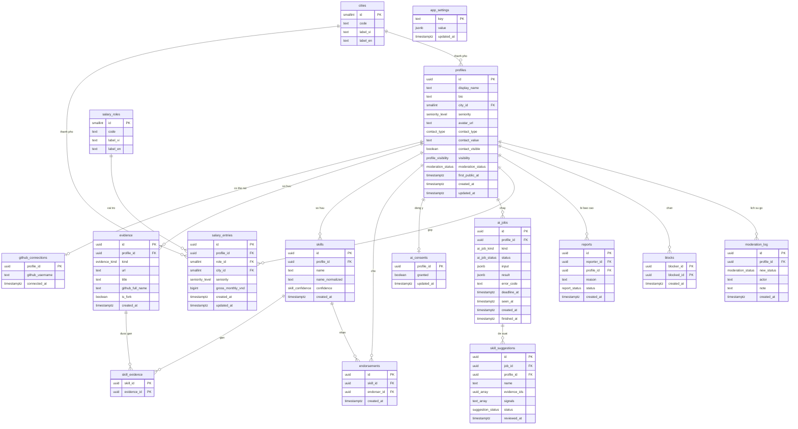
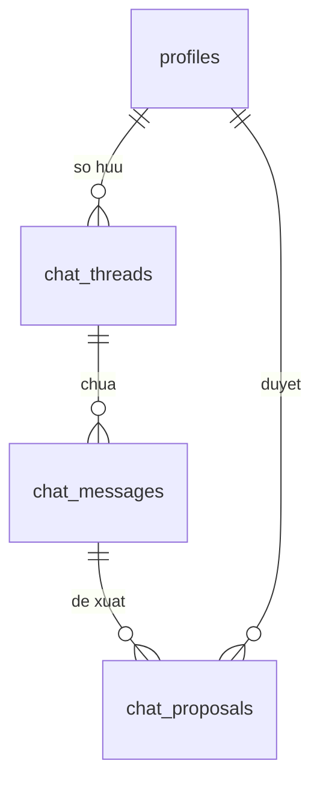

# Mô hình dữ liệu (DATA_MODEL)

> v1.0 · Đã thống nhất · 2026-10-22 · Chỉ là thiết kế trên giấy, **chưa có migration**. Postgres 17 (Supabase local, `major_version = 17`). Thuật ngữ: [GLOSSARY.md](../../GLOSSARY.md). Quyết định liên quan: [ADR-0006](../adr/0006-data-access-rls-rpc-edge-functions.md).

## 1. Quy ước

- Mọi bảng nằm trong schema `public`, tên số nhiều, `snake_case`. Khóa chính `uuid` (`gen_random_uuid()`) trừ khi ghi khác.
- `profiles.id` = `auth.users.id`. Mọi bảng dữ liệu người dùng tham chiếu `profiles(id)` với `on delete cascade`, nên xóa `auth.users` (F-002) kéo theo xóa hết.
- **Mọi bảng đều bật RLS** (kể cả bảng tham chiếu và bảng nội bộ). Bảng không có policy cho `anon`/`authenticated` nghĩa là app không đọc/ghi được.
- Thời gian: `timestamptz`, mặc định `now()`. "Tháng" cho hạn mức = tháng dương lịch theo múi giờ `Asia/Ho_Chi_Minh` [GIẢ ĐỊNH] (A-017, A-020).
- `auth.uid()` là id người đang gọi.

## 2. Kiểu liệt kê (enum)

| Enum Postgres | Giá trị | Dart (ADR-0008) | Nguồn |
|---|---|---|---|
| `profile_visibility` | `private`, `public` | `ProfileVisibility` | F-003 |
| `moderation_status` | `active`, `removed` | `ModerationStatus` | F-013, A-027 |
| `seniority_level` | `intern`, `fresher`, `junior`, `middle` | `SeniorityLevel` | F-003, F-015, D-032 |
| `contact_type` | `email`, `linkedin` | `ContactLinkType` | F-003, D-042 |
| `evidence_kind` | `github_repo`, `article`, `product` | `EvidenceKind` | F-004, F-005 |
| `skill_confidence` | `self_claimed`, `evidenced`, `endorsed` | `SkillConfidence` | F-009 |
| `ai_job_kind` | `extract_skills`, `gap_analysis` | `AiJobKind` | F-007, F-014 |
| `ai_job_status` | `queued`, `running`, `succeeded`, `failed`, `timed_out` | `AiJobStatus` | F-007, D-035 |
| `suggestion_status` | `pending`, `accepted`, `rejected` | `SuggestionStatus` | F-007 |
| `report_status` | `open`, `resolved` | — (chỉ admin) | F-013 |

## 3. Sơ đồ quan hệ (ERD)

`uuid_array` và `text_array` trong sơ đồ là `uuid[]` và `text[]` (Mermaid không cho dấu `[]` trong kiểu).

## 4. Chi tiết bảng

### 4.1 `profiles` — hồ sơ ứng viên (F-003, F-011, F-013, F-016)

| Cột | Kiểu | Ràng buộc | Ghi chú |
|---|---|---|---|
| `id` | `uuid` | PK, FK `auth.users(id)` `on delete cascade` | |
| `display_name` | `text` | `not null`, `char_length between 1 and 60` [GIẢ ĐỊNH: 60] | bắt buộc (D-042) |
| `bio` | `text` | `char_length(bio) <= 300` | D-044 |
| `city_id` | `smallint` | FK `cities(id)`, null được | cùng danh sách với lương |
| `seniority` | `seniority_level` | null được | cùng danh sách F-015 |
| `avatar_url` | `text` | null được; **app không ghi được** | trigger điền từ metadata GitHub/Google khi tạo; email/Apple → null = ảnh mặc định (A-024). [CHƯA XÁC MINH] tên khóa `avatar_url` trong `raw_user_meta_data` |
| `contact_type` | `contact_type` | check: cả `contact_type` và `contact_value` cùng null hoặc cùng có | |
| `contact_value` | `text` | `email` phải giống định dạng email; `linkedin` phải bắt đầu `https://www.linkedin.com/` hoặc `https://linkedin.com/` [GIẢ ĐỊNH] | |
| `contact_visible` | `boolean` | `not null default false` | A-025 |
| `visibility` | `profile_visibility` | `not null default 'private'` | F-003 |
| `moderation_status` | `moderation_status` | `not null default 'active'`; **chỉ admin đổi** | A-027 |
| `first_public_at` | `timestamptz` | trigger điền lần đầu `visibility` thành `public`; app không ghi được | đo `activationRate` (A-022) |
| `created_at`, `updated_at` | `timestamptz` | `not null default now()`; trigger cập nhật `updated_at` | |

Chỉ mục: partial index `(id) where visibility = 'public' and moderation_status = 'active'` để lọc nhanh trong tìm kiếm.
Trigger: đổi `moderation_status` → ghi `moderation_log` (A-027, R-008).
Quyền cột: `authenticated` chỉ được `insert/update` các cột `display_name, bio, city_id, seniority, contact_type, contact_value, contact_visible, visibility` (column privileges), nên người dùng không tự "gỡ" hay "khôi phục" được hồ sơ của mình.

### 4.2 `github_connections` — kết nối GitHub (F-004)

| Cột | Kiểu | Ràng buộc | Ghi chú |
|---|---|---|---|
| `profile_id` | `uuid` | PK, FK `profiles(id)` cascade | một kết nối mỗi người |
| `github_username` | `text` | `not null` | do RPC `connect_github` đọc từ `auth.identities`, **không** lấy từ app (chống khai tên GitHub của người khác). [CHƯA XÁC MINH] khóa `user_name` trong `identity_data` |
| `connected_at` | `timestamptz` | `not null default now()` | đo `activationRate` |

Ngắt kết nối = xóa dòng này; trigger xóa mọi `evidence` có `kind = 'github_repo'` của người đó (F-004). Không gỡ danh tính GitHub khỏi tài khoản đăng nhập [GIẢ ĐỊNH], vì người đăng nhập bằng GitHub không thể gỡ danh tính duy nhất của mình.

### 4.3 `evidence` — bằng chứng: repo hoặc link (F-004, F-005)

| Cột | Kiểu | Ràng buộc | Ghi chú |
|---|---|---|---|
| `id` | `uuid` | PK | |
| `profile_id` | `uuid` | FK `profiles(id)` cascade, `not null` | |
| `kind` | `evidence_kind` | `not null` | |
| `url` | `text` | `not null`, check `url ~ '^https?://[^\s/$.?#].[^\s]*$'`, dài ≤ 2048 | F-005: URL sai bị từ chối |
| `title` | `text` | ≤ 200 ký tự | link: người dùng đặt; repo: tên repo |
| `github_full_name` | `text` | bắt buộc khi `kind = 'github_repo'`, null khi khác | `owner/name` |
| `is_fork` | `boolean` | `not null default false` | |
| `created_at` | `timestamptz` | `not null default now()` | |

Ràng buộc:
- `unique (profile_id, github_full_name)`, `unique (profile_id, url)`.
- Trigger trước khi `insert`: đếm theo nhóm — `github_repo` ≤ 10 (D-045), `article` + `product` ≤ 10 (D-043); vượt → lỗi `P0001` với mã `EVIDENCE_LIMIT`.
Chỉ mục: `(profile_id, kind)`.

### 4.4 `skills` — skill trên hồ sơ (F-007, F-008, F-009)

| Cột | Kiểu | Ràng buộc | Ghi chú |
|---|---|---|---|
| `id` | `uuid` | PK | |
| `profile_id` | `uuid` | FK `profiles(id)` cascade | |
| `name` | `text` | `not null`, 1–50 ký tự [GIẢ ĐỊNH] | hiển thị nguyên văn |
| `name_normalized` | `text` | generated: `lower(regexp_replace(btrim(name), '\s+', ' ', 'g'))` | so khớp tìm kiếm và điều kiện người xác nhận (ALG-02) |
| `confidence` | `skill_confidence` | `not null default 'self_claimed'`; **chỉ trigger ghi** | ALG-01 |
| `created_at` | `timestamptz` | `not null default now()` | |

`unique (profile_id, name_normalized)`. Chỉ mục: `(name_normalized text_pattern_ops)` cho tìm theo tiền tố (ALG-04).
Tối đa 50 skill mỗi hồ sơ [GIẢ ĐỊNH] (trigger) để chặn lạm dụng.

### 4.5 `skill_evidence` — gắn bằng chứng vào skill (F-008, F-009)

| Cột | Kiểu | Ràng buộc |
|---|---|---|
| `skill_id` | `uuid` | PK (cùng `evidence_id`), FK `skills(id)` cascade |
| `evidence_id` | `uuid` | FK `evidence(id)` cascade |

Trigger kiểm skill và evidence cùng một `profile_id`. Sau `insert/delete` → tính lại `skills.confidence` (ALG-01).

### 4.6 `endorsements` — lượt xác nhận skill (F-010, F-002)

| Cột | Kiểu | Ràng buộc |
|---|---|---|
| `id` | `uuid` | PK |
| `skill_id` | `uuid` | FK `skills(id)` cascade, `not null` |
| `endorser_id` | `uuid` | FK `profiles(id)` cascade, `not null` |
| `created_at` | `timestamptz` | `not null default now()` |

`unique (skill_id, endorser_id)` (A-006). Chỉ mục: `(endorser_id, created_at)` để đếm hạn mức tháng.
Chỉ tạo qua RPC `endorse_skill` (ALG-02). Sau `insert/delete` → tính lại `confidence` của skill đó. Khi người dùng A chặn B, trigger trên `blocks` xóa các lượt B đã xác nhận cho A [GIẢ ĐỊNH].

### 4.7 `ai_consents` — đồng ý dùng AI (F-006)

| Cột | Kiểu | Ràng buộc |
|---|---|---|
| `profile_id` | `uuid` | PK, FK `profiles(id)` cascade |
| `granted` | `boolean` | `not null` |
| `updated_at` | `timestamptz` | `not null default now()` |

Không có dòng = chưa trả lời; `granted = false` = từ chối hoặc đã rút lại.

### 4.8 `ai_jobs` — lượt chạy AI (F-007, F-014, F-018)

| Cột | Kiểu | Ràng buộc | Ghi chú |
|---|---|---|---|
| `id` | `uuid` | PK | |
| `profile_id` | `uuid` | FK `profiles(id)` cascade | |
| `kind` | `ai_job_kind` | `not null` | |
| `status` | `ai_job_status` | `not null default 'queued'` | ALG-05 |
| `input` | `jsonb` | | `gap_analysis`: `{ "job_description": "…" }` (≤ 8.000 ký tự [GIẢ ĐỊNH]); `extract_skills`: id các nguồn đã đọc |
| `result` | `jsonb` | | `gap_analysis`: xem API_CONTRACT § 4.3 |
| `error_code` | `text` | | `GITHUB_UNAVAILABLE`, `SOURCE_UNREADABLE`, `TIMEOUT`, `INTERNAL` |
| `deadline_at` | `timestamptz` | `not null` | `created_at + ai_timeout_seconds` |
| `seen_at` | `timestamptz` | app chỉ được ghi cột này | tắt dấu báo "đã xong" (F-007) |
| `created_at`, `finished_at` | `timestamptz` | | |

Chỉ mục: `(profile_id, kind, created_at desc)`.
Tên mã `ai_*` giữ theo GLOSSARY dù xử lý bằng bộ quy tắc tự xây (ADR-0010).
Partial unique index `(profile_id, kind) where status in ('queued','running')` → mỗi người tối đa một lượt đang chạy cho mỗi loại.

### 4.9 `skill_suggestions` — skill AI đề xuất (F-007)

| Cột | Kiểu | Ràng buộc |
|---|---|---|
| `id` | `uuid` | PK |
| `job_id` | `uuid` | FK `ai_jobs(id)` cascade |
| `profile_id` | `uuid` | FK `profiles(id)` cascade |
| `name` | `text` | `not null`, 1–50 ký tự |
| `evidence_ids` | `uuid[]` | `not null`, ≥ 1 phần tử (mỗi đề xuất phải có nguồn) |
| `signals` | `text[]` | `not null`, ≥ 1 phần tử, ví dụ `{"dependency:pub:provider","language:Dart"}` — dấu hiệu đã dùng (ALG-08) |
| `status` | `suggestion_status` | `not null default 'pending'` |
| `reviewed_at` | `timestamptz` | |
| `catalog_id` | `text` | FK `skill_catalog(id)`, khóa của quy tắc, không phải chữ hiển thị |
| `commit_metrics` | `jsonb` | số đã đếm trong cửa sổ quét; `scan_truncated` nghĩa là chưa phải tổng |

Chỉ mục: `(profile_id, status)`. Duyệt qua RPC `review_suggestion` (ALG-03).
`signals` + `status` là dữ liệu để đo độ chính xác từng quy tắc và để huấn luyện bộ phân loại về sau (ADR-0010).
`skill_catalog.verifiability` nhận `file`, `package` hoặc `unverifiable`. Giá trị cuối nghĩa là commit không kiểm được skill đó.

### 4.10 `salary_roles`, `cities` — danh sách cố định (F-015, F-003, A-008)

| Cột | Kiểu | Ràng buộc |
|---|---|---|
| `id` | `smallint` | PK |
| `code` | `text` | `unique not null` (ví dụ `mobile_developer`, `hcm`) |
| `label_vi`, `label_en` | `text` | `not null` |

Nạp sẵn bằng seed. Nội dung đã được chủ dự án chốt ngày 2026-10-22:
- Vai trò: Mobile developer, Frontend developer, Backend developer, Fullstack developer, QA/Tester, Data/AI, DevOps, Khác.
- Thành phố: Hà Nội, TP. Hồ Chí Minh, Đà Nẵng, Thành phố khác, Làm từ xa.
Dùng danh sách cố định (không cho gõ tự do) vì nhóm lương theo vai trò + thành phố + cấp bậc chỉ đếm đúng khi giá trị trùng khớp.

### 4.11 `salary_entries` — khoản lương góp (F-015, F-002)

| Cột | Kiểu | Ràng buộc |
|---|---|---|
| `id` | `uuid` | PK |
| `profile_id` | `uuid` | FK `profiles(id)` cascade, `not null` |
| `role_id` | `smallint` | FK `salary_roles(id)`, `not null` |
| `city_id` | `smallint` | FK `cities(id)`, `not null` |
| `seniority` | `seniority_level` | `not null` |
| `gross_monthly_vnd` | `bigint` | `not null`, `between 1000000 and 500000000` [GIẢ ĐỊNH: chặn số gõ nhầm] |
| `created_at`, `updated_at` | `timestamptz` | |

`unique (profile_id, role_id, city_id, seniority)` — cách hiểu "mỗi người một khoản cho mỗi công việc" (A-007) [GIẢ ĐỊNH]. Tối đa 5 khoản mỗi người [GIẢ ĐỊNH] để một người không làm lệch nhóm.
Chỉ mục: `(role_id, city_id, seniority)`. Không bảng nào khác tham chiếu tới khoản lương; không có cột tên/email.

### 4.12 `reports` — báo cáo (F-013)

| Cột | Kiểu | Ràng buộc |
|---|---|---|
| `id` | `uuid` | PK |
| `reporter_id` | `uuid` | FK `profiles(id)` **`on delete set null`** [GIẢ ĐỊNH: giữ báo cáo cho admin khi người báo cáo xóa tài khoản] |
| `profile_id` | `uuid` | FK `profiles(id)` cascade, `not null` |
| `reason` | `text` | `not null`, 1–500 ký tự |
| `status` | `report_status` | `not null default 'open'` |
| `created_at` | `timestamptz` | |

Check `reporter_id <> profile_id`. Chỉ mục: `(status, created_at)` để admin xem trong Studio.

### 4.13 `blocks` — chặn (F-013, F-010, F-012)

| Cột | Kiểu | Ràng buộc |
|---|---|---|
| `blocker_id` | `uuid` | PK (cùng `blocked_id`), FK `profiles(id)` cascade |
| `blocked_id` | `uuid` | FK `profiles(id)` cascade |
| `created_at` | `timestamptz` | |

Check `blocker_id <> blocked_id`. Chỉ mục phụ: `(blocked_id)`.

### 4.14 `moderation_log` — lịch sử gỡ hồ sơ (A-027, R-008)

| Cột | Kiểu | Ràng buộc |
|---|---|---|
| `id` | `uuid` | PK |
| `profile_id` | `uuid` | FK `profiles(id)` **`on delete set null`** |
| `new_status` | `moderation_status` | `not null` |
| `actor` | `text` | `not null default current_user` (Studio ghi `postgres`) |
| `note` | `text` | |
| `created_at` | `timestamptz` | |

Chỉ trigger ghi. [GIẢ ĐỊNH] Với một admin duy nhất (A-013), `actor` = vai trò CSDL là đủ.

### 4.15 `app_settings` — cấu hình đổi được không cần phát hành app (F-018, F-007)

| Khóa (`key`) | Giá trị mặc định | Nguồn |
|---|---|---|
| `ai_quota_extract_per_month` | `3` | D-036 |
| `ai_quota_gap_per_month` | `10` | D-036 |
| `ai_timeout_seconds` | `120` [GIẢ ĐỊNH: dưới giới hạn 150 giây của Edge Function gói miễn phí] | F-007, D-035 |
| `endorsements_per_month` | `10` | D-031 |
| `salary_min_sample_size` | `5` | D-030 |

Không có khóa trần chi phí/giá token: xử lý bằng bộ quy tắc tự xây nên chi phí theo lượt bằng 0 (ADR-0010). Hai tiêu chí chi phí của F-018 luôn được thỏa.

## 5. Ma trận RLS

Ký hiệu: **S** select, **I** insert, **U** update, **D** delete; "—" không có quyền. "Chủ" = `auth.uid()` là chủ dòng. "Người khác" = đã đăng nhập nhưng không phải chủ. `service_role` (Edge Functions) và admin trong Supabase Studio (vai trò `postgres`) **bỏ qua RLS**. Đọc chéo người dùng chỉ qua RPC `security definer` ([API_CONTRACT.md](API_CONTRACT.md)).

| Bảng | RLS | `anon` | Chủ | Người khác | `service_role` / admin | Policy chính |
|---|---|---|---|---|---|---|
| `profiles` | Bật | — | S, I, U (cột cho phép) | — (qua RPC) | Toàn quyền | `id = auth.uid()`; không có D (xóa qua `delete-account`) |
| `github_connections` | Bật | — | S, D | — | Toàn quyền | I chỉ qua RPC `connect_github` |
| `evidence` | Bật | — | S; I/U/D với `kind in ('article','product')`; D với `github_repo` | — (qua RPC) | Toàn quyền | `profile_id = auth.uid()`; repo chỉ ghi qua `github-repos` |
| `skills` | Bật | — | S, I (`name`), D | — (qua RPC) | Toàn quyền | `confidence` không cấp quyền ghi |
| `skill_evidence` | Bật | — | S, I, D | — | Toàn quyền | `exists` skill của chủ **và** evidence của chủ |
| `endorsements` | Bật | — | S lượt nhận trên skill của mình; S, D lượt mình đã cho | — | Toàn quyền | I chỉ qua RPC `endorse_skill` |
| `ai_consents` | Bật | — | S, I, U | — | Toàn quyền | `profile_id = auth.uid()` |
| `ai_jobs` | Bật | — | S; U chỉ cột `seen_at` | — | Toàn quyền | I/D chỉ Edge Functions |
| `skill_suggestions` | Bật | — | S | — | Toàn quyền | duyệt qua RPC `review_suggestion` |
| `salary_roles` | Bật | — | S | S | Toàn quyền | chỉ đọc |
| `cities` | Bật | — | S | S | Toàn quyền | chỉ đọc |
| `salary_entries` | Bật | — | S, I, U, D | — | Toàn quyền | `profile_id = auth.uid()`; số liệu gộp qua RPC |
| `reports` | Bật | — | I (`reporter_id = auth.uid()`) | — | Toàn quyền | không ai đọc qua app |
| `blocks` | Bật | — | S, I, D (`blocker_id = auth.uid()`) | — | Toàn quyền | người bị chặn không biết mình bị chặn |
| `moderation_log` | Bật | — | — | — | Toàn quyền | chỉ trigger ghi |
| `app_settings` | Bật | — | — | — | Toàn quyền | đọc qua RPC `get_ai_quota` |
Kiểm RLS bằng pgTAP trong `supabase/tests/` (xem [TRACEABILITY.md](TRACEABILITY.md)): mỗi bảng ít nhất một test "chủ làm được" và một test "người khác/anon không làm được".

## 6. Xóa tài khoản kéo theo gì (F-002)

`delete-account` gọi `auth.admin.deleteUser(uid)` → xóa `auth.users` → cascade xóa `profiles` → cascade xóa `github_connections`, `evidence`, `skills`, `skill_evidence`, `endorsements` (cả lượt đã nhận và lượt đã cho), `ai_consents`, `ai_jobs`, `skill_suggestions`, `salary_entries`, `blocks`, `reports` nhận được. Trigger trên `endorsements` tính lại `confidence` cho skill của người khác. Số liệu lương gộp luôn tính lúc gọi nên tự đúng. `reports.reporter_id` và `moderation_log.profile_id` thành null.

## 7. Lịch sử

| Phiên bản | Ngày | Thay đổi |
|---|---|---|
| 0.1 | 2026-10-22 | Bản nháp đầu |
| 1.0 | 2026-10-22 | Đã thống nhất v1.0 |
| Nháp | 2026-10-28 | Thêm mục 8 cho ô chat. Chưa có migration | Chờ xác nhận F-025 |

## 8. Nháp: ô chat (F-025, chờ xác nhận)

Chưa có bảng thật. Chỉ thêm sau khi chủ dự án xác nhận biên bản, mục 11.

### `chat_threads`

| Cột | Kiểu | Ràng buộc |
|---|---|---|
| `id` | `uuid` | PK |
| `profile_id` | `uuid` | FK `profiles(id)` cascade, `not null` |
| `created_at` | `timestamptz` | |
| `updated_at` | `timestamptz` | |

Một người có thể có nhiều cuộc. Bản đầu app mở cuộc mới nhất.

### `chat_messages`

| Cột | Kiểu | Ràng buộc |
|---|---|---|
| `id` | `uuid` | PK |
| `thread_id` | `uuid` | FK `chat_threads(id)` cascade, `not null` |
| `profile_id` | `uuid` | FK `profiles(id)` cascade, `not null` |
| `role` | `text` | `user` hoặc `assistant` |
| `body` | `text` | `not null`, 1–4.000 ký tự |
| `provider` | `text` | `ollama`, `groq`, `zai`, hoặc rỗng với câu của người dùng |
| `created_at` | `timestamptz` | |

Không lưu đoạn repo, mô tả tin, lương, email, cách liên hệ vào bảng này. Những phần đó chỉ ghép lúc gửi, rồi bỏ.

### `chat_proposals`

| Cột | Kiểu | Ràng buộc |
|---|---|---|
| `id` | `uuid` | PK |
| `message_id` | `uuid` | FK `chat_messages(id)` cascade, `not null` |
| `profile_id` | `uuid` | FK `profiles(id)` cascade, `not null` |
| `title` | `text` | 1–200 ký tự, tên đề xuất |
| `detail` | `text` | tối đa 500 ký tự |
| `status` | `suggestion_status` | `pending`, `accepted`, `rejected` |
| `reviewed_at` | `timestamptz` | |

Bấm Nhận hoặc Bỏ ghi vào đây. Đó là dữ liệu để train sau. Bản này không có bảng train và không có cột chi phí.

RLS: chủ được đọc cuộc, tin nhắn và đề xuất của mình. Người khác và khách không đọc được. Chủ được thêm câu của mình và đổi trạng thái đề xuất của mình. Câu của agent chỉ phần chạy trên server được ghi. Xóa tài khoản xóa cả ba bảng theo cascade.
