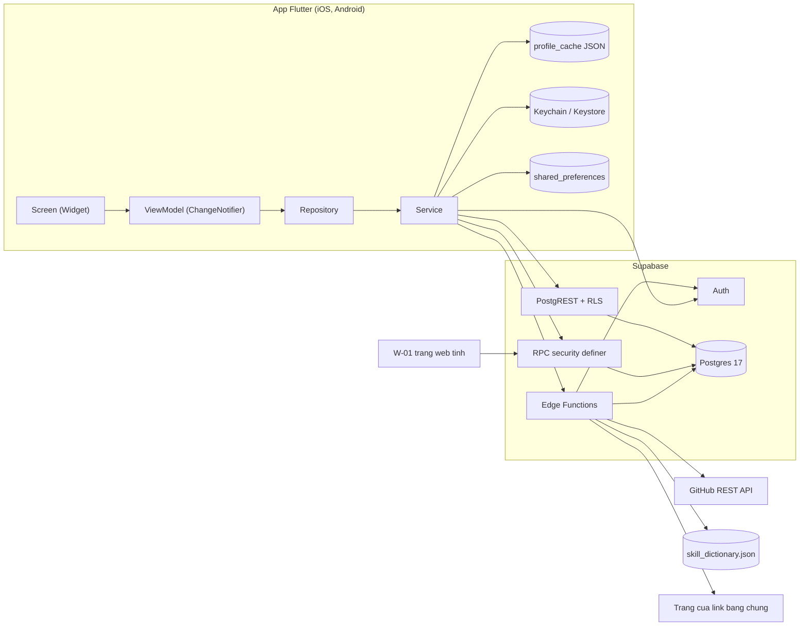
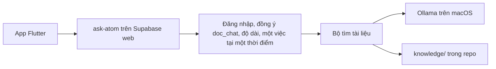

# Thiết kế kỹ thuật (TECH_DESIGN)

> v1.0 · Đã thống nhất · 2026-10-22 · Tài liệu gốc của phần thiết kế. Yêu cầu: [SPEC.md](../SPEC.md), [FEATURES.md](../FEATURES.md). Quyết định: [docs/adr/](../adr/).

| Tài liệu | Nội dung |
|---|---|
| [DATA_MODEL.md](DATA_MODEL.md) | Bảng, ràng buộc, chỉ mục, ma trận RLS |
| [API_CONTRACT.md](API_CONTRACT.md) | RPC, Edge Functions, phần dùng REST tự sinh |
| [ALGORITHMS.md](ALGORITHMS.md) | Logic không hiển nhiên + test mẫu |
| [UI_DESIGN.md](UI_DESIGN.md) | Màn hình, điều hướng, trạng thái, design tokens, tiếp cận |
| [DEPENDENCIES.md](DEPENDENCIES.md) | Package, phiên bản, nguồn |
| [TRACEABILITY.md](TRACEABILITY.md) | F-xxx → màn hình → bảng/RPC → test |

## 1. Kiến trúc tổng thể



- **App:** MVVM (ADR-0001). Luồng một chiều: Screen gọi lệnh ViewModel → Repository → Service; dữ liệu đi ngược lại qua `notifyListeners()`.
- **Service** chỉ bọc một nguồn (Supabase client, file cache, secure storage, `shared_preferences`, clipboard/url_launcher). **Repository** gộp nguồn, ánh xạ lỗi, quyết định dùng cache (ALG-06).
- **Supabase:** REST + RLS cho dữ liệu của mình, RPC cho quy tắc chéo người dùng, Edge Functions cho việc cần bí mật hoặc gọi ra ngoài (ADR-0006).
- **Web:** một trang tĩnh gọi `get_public_profile` (ADR-0007).
- Không có realtime, push, analytics trong MVP.

### Chatbot hỏi tài liệu (ADR-0012, chưa làm)

Ô chat cũ không nằm trên sơ đồ này và không đổi. Sơ đồ dưới là cửa thứ hai.



- Điện thoại không gọi thẳng bộ tìm, và không giữ chìa khóa.
- Ollama chạy trên macOS, không nằm trong Docker. Bộ tìm, nếu là AnythingLLM, chạy trong Docker và gọi Ollama qua địa chỉ nội bộ của máy. Chưa chọn AnythingLLM hay pgvector.
- Khóa của bot tài liệu, nếu có, chỉ nằm trong env cục bộ. Câu "không có khóa AI" ở mục 2 ở trên nói về trích skill theo ADR-0010, không nói về ô chat cũ hay bot này.
- Bot này không gọi Groq hay Z.ai.

### Ô chat cũ

Đọc từ code ngày 2026-10-30. Hàm là `chat-ask`, không phải `ask-atom`.

- Máy nhà là Ollama. Địa chỉ thử lần lượt: biến `OLLAMA_BASE_URL` nếu có, rồi `http://host.docker.internal:11434`, rồi `http://127.0.0.1:11434` (`supabase/functions/chat-ask/index.ts` dòng 25–28). Hỏi model tại đường `/api/chat` (dòng 44). Tên model: model nào bắt đầu bằng `atom-local`, không có thì lấy model đầu danh sách `/api/tags` (dòng 42). Không có một tên model cố định trong code. Timeout danh sách model 2 giây (dòng 32). Timeout câu trả lời 20 giây (dòng 47).
- Hết máy nhà thì Groq, rồi Z.ai (`supabase/functions/_shared/chat.ts` dòng 63–68). Groq gọi `https://api.groq.com/openai/v1/chat/completions`, model lấy từ `GROQ_MODEL`, không có thì `openai/gpt-oss-20b` (`chat-ask/index.ts` dòng 304–308). Z.ai gọi `https://api.z.ai/api/paas/v4/chat/completions`, model `glm-4.7-flash` (dòng 312–316). Timeout mỗi bên 20 giây (dòng 83).
- Khóa gắn bằng `Deno.env.get('GROQ_API_KEY')` và `Deno.env.get('ZAI_API_KEY')` (dòng 300–301). Tên biến khai trong `supabase/config.toml` dòng 421–422, giá trị lấy từ env, không ghi trong file. Không có khóa thì bỏ qua bên đó (dòng 304 và 312).
- Đồng ý: hàm `chat_gate` kiểm bảng `ai_consents`, cột `granted` đúng (`supabase/migrations/20261028140000_chat.sql` dòng 82–86). Không có loại đồng ý riêng cho ô chat. JWT không đọc được thì hàm trả `CONSENT_REQUIRED` (`chat-ask/index.ts` dòng 268).
- 30 câu mỗi tháng: `app_settings` khóa `chat_quota_per_month`, giá trị `30` (migration chat dòng 4–5). Đếm dòng `chat_messages` vai trò `user` từ đầu tháng giờ Việt Nam (`chat.sql` dòng 88–96, `ai_month_start` ở `supabase/migrations/20261025150000_skill_suggestions.sql` dòng 91–97). Câu chỉ được ghi sau khi có trả lời (`chat-ask/index.ts` dòng 321–325), nên lượt lỗi không vào bộ đếm.
- Hội thoại lưu ở `chat_threads`, `chat_messages` (cột `body`, `provider`), và `chat_proposals` (`chat.sql` dòng 8–39).

### Giới hạn AI

Một bảng cho mọi giới hạn đang mô tả. Bot mới chưa có dòng trong `app_settings`.

| Việc | Giới hạn | Nơi cấu hình |
|---|---|---|
| Ô chat cũ, số câu | 30 câu của người dùng mỗi tháng | `app_settings.chat_quota_per_month`, đếm trong `chat_gate` |
| Ô chat cũ, độ dài | 1 đến 4000 ký tự | `chat_gate` trong `supabase/migrations/20261028140000_chat.sql` dòng 79–80 |
| Trích skill | 3 lượt thành công hoặc đang chạy mỗi tháng | `app_settings.ai_quota_extract_per_month`, đếm trong `ai_begin_job` (`supabase/migrations/20261028120000_gap_community_notices.sql` dòng 44–55) |
| So với tin tuyển dụng | 10 lượt thành công hoặc đang chạy mỗi tháng | `app_settings.ai_quota_gap_per_month`, cùng hàm `ai_begin_job` |
| Việc trích hoặc so đang chạy | Một việc mỗi loại cho mỗi người | `ai_begin_job`, dòng 35–41 của migration trên |
| Hết giờ việc trích hoặc so | 120 giây | `app_settings.ai_timeout_seconds` |
| Bot hỏi tài liệu, độ dài | 1 đến 300 ký tự | ADR-0012 mục 9 và hợp đồng `ask-atom`. Chưa có khóa trong `app_settings` |
| Bot hỏi tài liệu, một việc tại một thời điểm | Cả hệ thống một yêu cầu AI | ADR-0012 mục 9. Chưa có bảng khóa |
| Bot hỏi tài liệu, trần mỗi giờ | Chưa có số | Chưa có chỗ cấu hình. Chốt sau khi đo |

## 2. Cấu hình và môi trường

- Supabase trên web được phép khi chủ dự án yêu cầu (AGENTS.md quy tắc 3). Mã dự án trên web: `quphatkscppfwxzfkrnx`. Không ghi khóa service_role hay mật khẩu database vào repo. Đổi schema vẫn đi qua `supabase/migrations`. Chép dữ liệu người dùng lên web chỉ khi chủ dự án yêu cầu lần chép đó.
- App nhận `SUPABASE_URL` và `SUPABASE_PUBLISHABLE_KEY` qua `--dart-define`; đọc trong `lib/config/env.dart` bằng `String.fromEnvironment`. Giá trị không commit; `.env.example` chỉ có tên biến. (Đổi tên `SUPABASE_ANON_KEY` → `SUPABASE_PUBLISHABLE_KEY` trong `.env.example` khi triển khai [GIẢ ĐỊNH]; cùng một giá trị khóa.)
- App nhận thêm `PUBLIC_PROFILE_BASE_URL` (tên miền GitHub Pages, ADR-0007) để tạo link chia sẻ.
- Secret của Edge Functions (token GitHub chỉ đọc dữ liệu công khai; không có khóa AI, ADR-0010) đặt trong file env cục bộ đã bị `.gitignore` chặn (`.env*`), không đọc/ghi bởi agent.
- Khởi tạo: `Supabase.initialize(url:, publishableKey:, authOptions: FlutterAuthClientOptions(localStorage: SecureSessionStorage()))` (ADR-0005).

## 3. Cấu trúc thư mục dự kiến

```
lib/
  main.dart                      # điểm vào duy nhất: init Supabase, providers, router
  config/
    env.dart                     # String.fromEnvironment
  routing/
    router.dart                  # GoRouter, redirect, StatefulShellRoute
    routes.dart                  # hằng số đường dẫn
  domain/models/                 # model bất biến viết tay (ADR-0008)
    profile.dart  skill.dart  evidence.dart  endorsement.dart
    ai_job.dart  skill_suggestion.dart  salary_entry.dart
    salary_aggregate.dart  public_profile.dart  ai_quota.dart
  data/
    services/
      supabase_service.dart      # bọc SupabaseClient (auth, from, rpc, functions)
      secure_session_storage.dart
      profile_cache_service.dart # file JSON (ALG-06)
      preferences_service.dart   # ngôn ngữ
    repositories/
      auth_repository.dart  profile_repository.dart  evidence_repository.dart
      skill_repository.dart  endorsement_repository.dart  ai_repository.dart
      discover_repository.dart  salary_repository.dart  safety_repository.dart
      account_repository.dart  settings_repository.dart
  ui/
    core/
      theme/                     # AppColors, AppSpacing, ThemeData (UI_DESIGN § 5)
      widgets/                   # ConfidenceBadge, OfflineBanner, ErrorView, BusyButton
      result.dart                # Result<T> = Ok | Error
      app_failure.dart
    auth/  profile/  evidence/  skills/  discover/
    endorsement/  gap_analysis/  salary/  settings/
      # mỗi thư mục: <feature>_screen.dart + <feature>_view_model.dart
  l10n/
    app_en.arb  app_vi.arb       # l10n.yaml: arb-dir lib/l10n, template app_en.arb
test/                            # soi gương lib/
  fakes/                         # repository/service giả viết tay
  fixtures/                      # JSON mẫu cho model
supabase/
  migrations/                    # (chưa tạo) schema theo DATA_MODEL.md
  seed.sql                       # salary_roles, cities, app_settings
  tests/                         # pgTAP: RLS, RPC, trigger
  functions/
    _shared/  skill_dictionary.json  skill_rules.ts  github_client.ts
              link_reader.ts  database.types.ts  errors.ts
    github-repos/  extract-skills/  analyze-gap/  delete-account/
    tests/                       # deno test (make check-functions)
web/public_profile/              # W-01: index.html, app.js, styles.css
```

## 4. Xử lý lỗi

- **Kiểu kết quả:** repository trả `Result<T>` (`Ok(value)` | `Error(AppFailure)`), theo mẫu trong hướng dẫn kiến trúc Flutter; ViewModel không bắt ngoại lệ thô.
- **`AppFailure` (sealed):** `NetworkFailure`, `NotFoundFailure`, `ValidationFailure(code)`, `QuotaFailure(resetsAt)`, `ConsentRequiredFailure`, `UnauthorizedFailure`, `ServerFailure`.
- **Ánh xạ:**
  - Lỗi kết nối/hết giờ → `NetworkFailure` → màn hình hiện "Không có kết nối" + Thử lại, hoặc bản lưu (ALG-06).
  - `PostgrestException` `P0001` → đọc `message` làm mã (API_CONTRACT § 2); `23505` → trùng; `23514` → `ValidationFailure`.
  - `FunctionException` → đọc `error.code` trong body JSON; HTTP 429 → `QuotaFailure`, 403 `CONSENT_REQUIRED` → `ConsentRequiredFailure`.
  - `AuthException` khi làm mới phiên thất bại → đăng xuất cục bộ → router về `/sign-in`.
- **Thông báo:** mỗi mã lỗi có chuỗi trong `app_vi.arb`/`app_en.arb`; mã lạ → "Có lỗi, thử lại".
- **Kiểm tra dữ liệu nhập** ở cả app (báo sớm) và CSDL (chốt cuối, ràng buộc `check`/trigger) với cùng giới hạn (bio 300, 10 link, 10 repo…).
- **Log:** chỉ `debugPrint` ở bản debug; không gửi log/crash ra ngoài ở MVP [GIẢ ĐỊNH]. Edge Functions chỉ log id, mã lỗi, thời gian chạy, **không** log nội dung mô tả job, nội dung link, token hay khóa.

## 5. Bảo mật và quyền riêng tư

### 5.1 Lưu token và khóa
- Phiên đăng nhập (access + refresh token) chỉ nằm trong Keychain/Keystore qua `flutter_secure_storage` (ADR-0005); không trong `shared_preferences`, không trong file cache.
- App chỉ chứa khóa publishable/anon. Khóa `service_role` và token GitHub chỉ nằm trong secret của Edge Functions.
- Đăng nhập OAuth dùng luồng PKCE của `supabase_flutter` [CHƯA XÁC MINH: PKCE là mặc định ở bản 2.18.3; nếu không, đặt `authFlowType: AuthFlowType.pkce`].

### 5.2 Phân quyền
- RLS bật trên **mọi** bảng `public` (DATA_MODEL § 5); có test pgTAP duyệt `pg_tables` bảo đảm không bảng nào thiếu RLS.
- Quyền cột: người dùng không ghi được `moderation_status`, `avatar_url`, `first_public_at`, `confidence`.
- Mọi hàm `security definer`: `set search_path = ''`, tự kiểm `auth.uid()`. Postgres mặc định cấp quyền `EXECUTE` cho `PUBLIC`, nên phải `revoke execute … from public` rồi chỉ `grant` cho vai trò cần (`anon` chỉ có `get_public_profile`; hàm nội bộ như `ai_begin_job` chỉ `service_role`).
- `delete-account` lấy id từ JWT, không nhận id từ app.
- `github_username` lấy từ `auth.identities` phía server (chống gắn repo của người khác).
- Admin thao tác qua Supabase Studio; mọi lần gỡ ghi `moderation_log` (A-027, R-008).

### 5.3 Dữ liệu gửi ra ngoài
- Không gửi dữ liệu người dùng cho nhà cung cấp AI nào ở bước trích skill (ADR-0010). Bước trích skill gọi GitHub API cho repo công khai đã chọn. Trang link bài viết chưa được tải.
- Đầu vào bộ quy tắc được dựng bởi hàm thuần `buildExtractInput()` / `buildGapInput()` có unit test khẳng định **không** có khóa `salary`, `email`, `contact`, `display_name` (F-006).
- Đọc link bài viết: chưa làm. Khi làm sau, chỉ `http/https`, chặn IP nội bộ, tối đa 1 MB và 10 giây.

### 5.4 Quyền riêng tư
- Hồ sơ mặc định riêng tư; liên hệ mặc định ẩn; trang công khai chỉ hiện trường đã chọn.
- Lương: không gắn tên/email, chỉ số liệu gộp từ 5 khoản, làm tròn, không trả số khoản (ALG-07).
- Xóa tài khoản xóa thật (cascade), không xóa mềm; bản lưu trên máy bị xóa khi đăng xuất/xóa tài khoản.
- Khung pháp lý tham chiếu Nghị định 13/2023/NĐ-CP (A-003) và khai báo quyền riêng tư trên hai store (A-015) — cần chủ dự án/người có chuyên môn xác nhận trước thử nghiệm kín [MỞ].

## 6. Yêu cầu phi chức năng (NFR): mục tiêu đo được và cách kiểm

| Mã | Yêu cầu | Mục tiêu | Cách kiểm | Nguồn |
|---|---|---|---|---|
| NFR-01 | Giao diện không bị khóa khi chờ | Mọi thao tác chờ mạng/AI hiện chỉ báo "đang xử lý" trong khung hình kế tiếp; phần còn lại vẫn cuộn/bấm được; không gọi mạng đồng bộ trên luồng UI | Widget test: bấm hành động với fake chậm → thấy chỉ báo và vẫn cuộn được danh sách. Con số thời gian cụ thể [MỞ] chốt sau thử nghiệm kín (Q-006) | F-016, D-035 |
| NFR-02 | Phân tích không treo | Không job nào ở "đang chạy" quá `ai_timeout_seconds` (mặc định 120 giây) + 5 giây | Test ALG-05 #4; thử thủ công với GitHub/link giả trả chậm | F-007, D-035 |
| NFR-03 | Đọc khi mất mạng | 50 hồ sơ mở gần nhất xem được khi tắt mạng | Unit test ALG-06; thử chế độ máy bay trên máy thật | F-016 |
| NFR-04 | Hai ngôn ngữ đủ | 0 chuỗi giao diện viết cứng; `app_vi.arb` và `app_en.arb` có cùng tập khóa | `untranslated-messages-file` trong `l10n.yaml` phải sinh file rỗng; unit test so tập khóa hai file ARB; `flutter analyze` | F-017 |
| NFR-05 | Tiếp cận | Tương phản chữ ≥ 4.5:1; vùng bấm ≥ 48×48 dp; mọi vùng bấm có nhãn; không tràn chữ ở cỡ lớn nhất | Widget test mỗi màn Must với `meetsGuideline(androidTapTargetGuideline)`, `labeledTapTargetGuideline`, `textContrastGuideline` (lưu ý: guideline này cho phép 3:1 với chữ lớn, nên bảng màu UI_DESIGN § 5.1 giữ ≥ 4.5:1 cho mọi cỡ chữ); test `textScaler` lớn; thử VoiceOver/TalkBack thủ công | F-019, A-014 |
| NFR-06 | Bảo mật token/khóa | Token chỉ ở Keychain/Keystore; 0 lần xuất hiện khóa `service_role` trong `lib/`, `web/` | Test `SecureSessionStorage` với fake; rà mã trước khi phát hành (đề xuất thêm bước tìm chuỗi vào `make check` khi triển khai, cần chủ dự án đồng ý vì đổi harness) | AGENTS.md, ADR-0005 |
| NFR-07 | Không lộ dữ liệu khi phân tích | 0 trường lương/email/liên hệ trong đầu vào phân tích; 0 yêu cầu gửi tới nhà cung cấp AI | Unit test hàm dựng đầu vào; giả lập `fetch` trong `deno test` và khẳng định chỉ gọi `api.github.com` và URL của link người dùng | F-006, ADR-0010 |
| NFR-08 | RLS đầy đủ | 100% bảng `public` bật RLS; mỗi bảng có test chủ được / người khác không được | pgTAP trong `make check-db` | ADR-0006 |
| NFR-09 | Chi phí phân tích | 0 USD theo lượt (không gọi dịch vụ trả phí theo lượt); hạn mức lượt đổi được qua `app_settings` | Test ALG-05 #1–#3; rà DEPENDENCIES.md không có dịch vụ AI trả phí | F-018, D-037, ADR-0010 |
| NFR-10 | Tương thích | iOS ≥ 15.0, Android ≥ 7.0 (minSdk 24) | Kiểm `IPHONEOS_DEPLOYMENT_TARGET` và `minSdk`; mọi package hỗ trợ (DEPENDENCIES.md) | D-038 |
| NFR-11 | Xóa sạch | Sau khi xóa tài khoản: 0 dòng chứa id đó trong mọi bảng `public` (trừ cột đã `set null`) | pgTAP: xóa người dùng trong `auth.users` rồi đếm từng bảng | F-002 |
| NFR-12 | Đo được kích hoạt | Tính được `activationRate` 7 ngày từ dữ liệu sẵn có | Truy vấn § 7 chạy được trên dữ liệu seed | D-040, A-022 |
| NFR-13 | Kiểm thử tự động | `make check` và `make check-db` xanh trước mỗi lần báo xong | Chạy lệnh, báo kết quả thật | SPEC, AGENTS.md |

NFR-14 đến NFR-16 là nháp cho F-025, chưa có hiệu lực. NFR-07 và NFR-09 vẫn giữ nguyên cho tìm skill và so với tin.

| Mã | Yêu cầu | Mục tiêu | Cách kiểm | Nguồn |
|---|---|---|---|---|
| NFR-14 | Ô chat không gửi dữ liệu cấm | 0 trường lương, email, liên hệ trong gói gửi agent; 0 lời gọi model mất phí | Test ALG-10 #5; giả lập `fetch` và kiểm địa chỉ chỉ là Ollama local, Groq hoặc Z.ai model miễn phí | F-025, D-048, D-050 |
| NFR-15 | Chat chỉ chủ đọc | Người khác đọc cuộc trò chuyện thì 0 dòng | pgTAP | F-025, D-052 |
| NFR-16 | Khóa không vào app | 0 lần chuỗi khóa Groq hoặc Z.ai trong `lib/` và `web/` | Rà mã trước khi báo xong | D-055 |

## 7. Đo tỷ lệ kích hoạt (D-040, A-022)

Người dùng "kích hoạt" khi, trong 7 ngày kể từ `auth.users.created_at`, có đủ: `github_connections.connected_at`, ≥ 1 `skill_suggestions` `accepted` (hoặc skill tự khai đã gắn bằng chứng) mà skill đó đang ở mức ≥ `evidenced`, và `profiles.first_public_at`. Chủ dự án chạy truy vấn này trong Studio; không cần công cụ phân tích bên ngoài. [GIẢ ĐỊNH] "Thời điểm cài" ≈ thời điểm tạo tài khoản; không có thời điểm duyệt skill tự khai nên dùng `skills.created_at` cho skill tự khai.

## 8. Kiểm thử

| Tầng | Công cụ | Chạy trong | Phạm vi |
|---|---|---|---|
| Unit | `flutter_test` | `make check` | model + fixture JSON, repository với fake service, ALG-06, so khóa ARB |
| Widget | `flutter_test` | `make check` | mỗi màn Must: trạng thái tải/trống/lỗi, `redirect`, guideline tiếp cận, `textScaler` lớn |
| CSDL | pgTAP (`supabase test db`) | `make check-db` | RLS từng bảng, RPC (ALG-01…04, 07), trigger, xóa tài khoản |
| Edge Functions | `deno test` | `make check-functions` (cài Deno khi viết Edge Function đầu tiên, chủ dự án đã đồng ý) | ALG-05, ALG-08, ALG-09, từ điển skill, dựng đầu vào, kiểm repo GitHub, `delete-account` |
| Thủ công | máy thật | trước thử nghiệm kín | OAuth từng nhà cung cấp, VoiceOver/TalkBack, chế độ máy bay |

Không dùng package mock; fake viết tay ở `test/fakes/`.

## 9. Việc cần chủ dự án quyết/làm trước khi triển khai (không tự làm)

- Thêm package vào `pubspec.yaml` (DEPENDENCIES.md) — AGENTS.md quy tắc 5.
- Bật `enable_manual_linking`, cấu hình nhà cung cấp OAuth trong `supabase/config.toml` — thay đổi đăng nhập.
- Cài Deno và thêm `make check-functions` — đã đồng ý, làm khi viết Edge Function đầu tiên.
- Tạo token GitHub chỉ đọc dữ liệu công khai cho Edge Functions (chủ dự án tự tạo; agent không đọc/ghi secret).
- Soạn từ điển skill ban đầu (~150 mục) — chủ dự án duyệt nội dung (ADR-0010).
- Cập nhật tài liệu yêu cầu lên v1.1 cho khớp ADR-0010 (cách gọi "AI", D-037) — nhiệm vụ riêng.

Đã chốt ngày 2026-10-22: không dùng nhà cung cấp AI (ADR-0010), host GitHub Pages (ADR-0007), danh sách vai trò/thành phố (DATA_MODEL § 4.10), kênh cảnh báo chi phí không còn cần.

## 10. Lịch sử

| Phiên bản | Ngày | Thay đổi |
|---|---|---|
| 0.1 | 2026-10-22 | Bản nháp đầu |
| 1.0 | 2026-10-22 | Đã thống nhất v1.0 |
