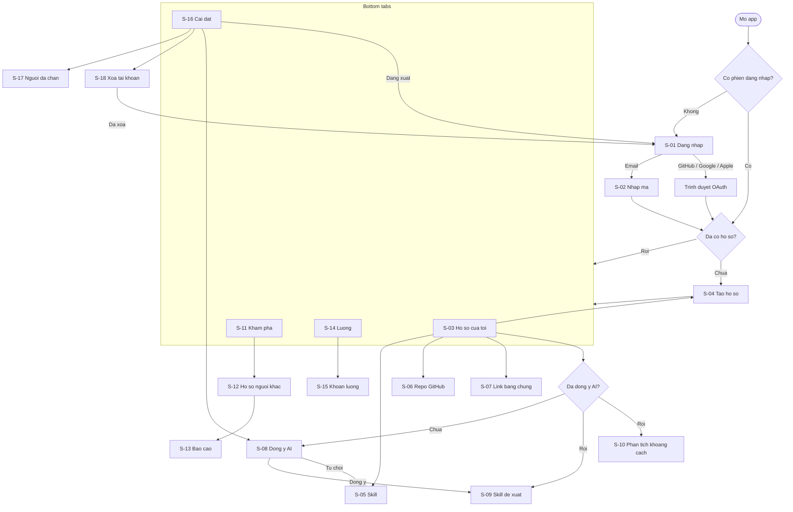

# Thiết kế giao diện (UI_DESIGN)

> v1.0 · Đã thống nhất · 2026-10-22 · Chữ trên giao diện gọi tính năng là "phân tích tự động" vì không dùng nhà cung cấp AI (ADR-0010); tên mã vẫn là `ai_*`. Điện thoại iOS 15+ / Android 7.0+ (D-038), chỉ chiều dọc, không tablet. Material 3 (`useMaterial3` mặc định trong Flutter 3.47). Chế độ tối không thuộc MVP [GIẢ ĐỊNH].

## 1. Danh sách màn hình

| Mã | Màn hình | Route (`go_router`, ADR-0002) | Tính năng |
|---|---|---|---|
| S-01 | Đăng nhập | `/sign-in` | F-001, F-017 |
| S-02 | Nhập mã email | `/sign-in/otp` | F-001 |
| S-03 | Hồ sơ của tôi (tab 1) | `/profile` | F-003, F-007, F-009, F-011, F-016 |
| S-04 | Sửa hồ sơ (cũng là bước tạo hồ sơ lần đầu) | `/profile/edit` | F-003 |
| S-05 | Thêm / sửa skill | `/profile/skills/new`, `/profile/skills/:skillId` | F-008, F-009 |
| S-06 | Chọn repo GitHub | `/profile/github` | F-004 |
| S-07 | Link bằng chứng | `/profile/links` | F-005 |
| S-08 | Đồng ý dùng AI | `/ai-consent?next=<route>` | F-006 |
| S-09 | Skill AI đề xuất | `/profile/suggestions` | F-007, F-018 |
| S-10 | Phân tích khoảng cách skill | `/profile/gap` | F-014, F-018 |
| S-11 | Khám phá (tab 2) | `/discover` | F-012 |
| S-12 | Hồ sơ người khác | `/u/:id` | F-010, F-012, F-013, F-016 |
| S-13 | Báo cáo (bottom sheet trên S-12, không phải route) | — | F-013 |
| S-14 | Lương (tab 3) | `/salary` | F-015 |
| S-15 | Thêm / sửa khoản lương | `/salary/entries/new`, `/salary/entries/:entryId` | F-015 |
| S-16 | Cài đặt (tab 4) | `/settings` | F-006, F-017, F-001 |
| S-17 | Người đã chặn | `/settings/blocked` | F-013 |
| S-18 | Xóa tài khoản | `/settings/delete-account` | F-002 |
| W-01 | Trang hồ sơ công khai (web, ADR-0007) | `https://<host>/p/?id=<id>` | F-011 |
| S-19 | Ô chat (đã có màn trong code) | `/profile/chat` | F-025 |

## 2. Luồng điều hướng



Quy tắc `redirect`: không có phiên → `/sign-in`; có phiên nhưng chưa có hàng `profiles` → `/profile/edit`; có phiên mà đang ở `/sign-in*` → `/profile`.

## 3. Khung màn hình (wireframe sơ đồ)

### S-01 Đăng nhập
```
┌──────────────────────────────┐
│            Atom              │
│  Chứng minh skill bằng       │
│  bằng chứng thật             │
│                              │
│  [ Email ________________ ]  │
│  [   Gửi mã đăng nhập     ]  │
│  ─────────── hoặc ─────────  │
│  [   Tiếp tục với GitHub  ]  │
│  [   Tiếp tục với Google  ]  │
│  [   Tiếp tục với Apple   ]  │  ← chỉ iOS
│                              │
│  Tiếng Việt | English        │
└──────────────────────────────┘
```

### S-02 Nhập mã email
```
┌──────────────────────────────┐
│ ←  Nhập mã                   │
│  Đã gửi mã 6 số tới          │
│  minh@example.com            │
│  [ _ _ _ _ _ _ ]             │  ← một ô, bàn phím số, autofill mã
│  (lỗi: Mã sai hoặc hết hạn)  │
│  [        Xác nhận        ]  │
│  Gửi lại mã (sau 60 giây)    │
└──────────────────────────────┘
```

### S-03 Hồ sơ của tôi
```
┌──────────────────────────────┐
│ Hồ sơ                  [Sửa] │
│ (o) Minh · Fresher · HCM     │
│ Giới thiệu ngắn…             │
│ Công khai hồ sơ      [  ●]   │
│ [ Chép link hồ sơ ]          │  ← chỉ khi công khai
│ ┌ Tự động ──────────────────┐│
│ │ ● Có 4 skill đề xuất mới  ││  ← dấu báo F-007
│ │ [Tìm skill tự động]   2/3 ││
│ │ [Phân tích khoảng cách]   ││
│ └───────────────────────────┘│
│ Skill                 [+ Thêm]│
│  Flutter   [Được xác nhận ·2]│
│  Dart      [Có bằng chứng]   │
│  Figma     [Tự khai]         │
│ Bằng chứng                   │
│  GitHub: 7 repo     [Chọn >] │
│  Link: 2/10         [Quản lý>]│
├──────────────────────────────┤
│ Hồ sơ | Khám phá | Lương | ⚙ │
└──────────────────────────────┘
```

### S-04 Sửa / tạo hồ sơ
```
┌──────────────────────────────┐
│ ←  Hồ sơ               [Lưu] │
│ Tên hiển thị *  [__________] │
│ Giới thiệu      [__________] │
│                 còn 245 ký tự│
│ Thành phố       [Chọn     v] │
│ Cấp bậc         [Chọn     v] │
│ Liên hệ         (•) Không    │
│                 ( ) Email    │
│                 ( ) LinkedIn │
│                 [__________] │
│ Hiện liên hệ trên hồ sơ [○ ] │
└──────────────────────────────┘
```

### S-05 Skill
```
┌──────────────────────────────┐
│ ←  Skill               [Lưu] │
│ Tên skill  [ Flutter      ]  │
│ Mức: Có bằng chứng           │
│ Bằng chứng gắn với skill     │
│  [x] minh-dev/todo_app       │
│  [ ] Bài viết: State mgmt…   │
│ Được xác nhận bởi 2 người    │
│ [ Xóa skill ]                │
└──────────────────────────────┘
```

### S-06 Chọn repo GitHub
```
┌──────────────────────────────┐
│ ←  Repo GitHub   Đã chọn 7/10│
│ Chỉ repo công khai.          │
│  [x] todo_app     · 2 ngày   │
│  [x] weather      · 1 tuần   │
│  [ ] flutter (fork) · 1 năm  │
│  …                           │
│ [      Lưu lựa chọn       ]  │
│ [ Ngắt kết nối GitHub ]      │
│ (chưa nối: [Kết nối GitHub]) │
└──────────────────────────────┘
```

### S-07 Link bằng chứng
```
┌──────────────────────────────┐
│ ←  Link bằng chứng      2/10 │
│  Bài viết · State mgmt…  [⋮] │
│  Sản phẩm · atom.app     [⋮] │
│ [+ Thêm link]                │
│  ┌ Thêm link ──────────────┐ │
│  │ Loại (•)Bài viết ( )SP  │ │
│  │ URL  [https://…       ] │ │
│  │ Tiêu đề [            ]  │ │
│  │ (lỗi: URL không hợp lệ) │ │
│  │ [Hủy]           [Lưu]   │ │
│  └─────────────────────────┘ │
└──────────────────────────────┘
```

### S-08 Đồng ý dùng AI
```
┌──────────────────────────────┐
│ ←  Phân tích tự động         │
│ Atom sẽ tự động đọc:         │
│  • Repo GitHub công khai     │
│    bạn đã chọn               │
│  • Link bằng chứng của bạn   │
│  • Mô tả job bạn dán vào     │
│ Không bao giờ dùng:          │
│  • Lương, email, liên hệ     │
│ Không gửi cho công ty AI nào.│
│ Rút lại được trong Cài đặt.  │
│ [ Từ chối ]   [ Đồng ý ]     │
└──────────────────────────────┘
```

### S-09 Skill AI đề xuất
```
┌──────────────────────────────┐
│ ←  Skill đề xuất             │
│ ⟳ Đang phân tích… (bạn có    │
│   thể rời màn hình)          │
│ — hoặc —                     │
│  Riverpod                    │
│   Nguồn: todo_app            │
│   [Bỏ]          [Thêm]       │
│  REST API                    │
│   Nguồn: weather, bài viết 1 │
│   [Bỏ]          [Thêm]       │
│ Còn 2/3 lượt tháng này       │
└──────────────────────────────┘
```

### S-10 Phân tích khoảng cách
```
┌──────────────────────────────┐
│ ←  Phân tích khoảng cách     │
│ Dán mô tả job                │
│ [__________________________] │
│ [__________________________] │
│ [   Phân tích (9/10 lượt)  ] │
│ Kết quả                      │
│  Đã có: Flutter, Git         │
│  Còn thiếu:                  │
│   • CI/CD — Gợi ý: …         │
│   • Testing — Gợi ý: …       │
└──────────────────────────────┘
```

### S-11 Khám phá
```
┌──────────────────────────────┐
│ [🔍 Tìm theo skill…        ] │
│  (o) Lan · Junior · HN       │
│      React [Có bằng chứng]   │
│  (o) Huy · Fresher · ĐN      │
│      React [Tự khai]         │
│  … (cuộn để tải thêm)        │
├──────────────────────────────┤
│ Hồ sơ | Khám phá | Lương | ⚙ │
└──────────────────────────────┘
```

### S-12 Hồ sơ người khác (+ S-13 Báo cáo)
```
┌──────────────────────────────┐
│ ←                        [⋮] │  ← ⋮: Báo cáo, Chặn
│ ⚠ Đang xem bản lưu 10:32     │  ← chỉ khi mất mạng
│   [Thử lại]                  │
│ (o) Lan · Junior · Hà Nội    │
│ Giới thiệu…                  │
│ Liên hệ: linkedin.com/in/…   │
│ Skill                        │
│  React [Được xác nhận ·3]    │
│        [Xác nhận] / [Rút lại]│
│ Bằng chứng                   │
│  todo_web ↗   Bài viết 1 ↗   │
└──────────────────────────────┘
 S-13 (bottom sheet):
 ┌ Báo cáo hồ sơ ─────────────┐
 │ Lý do [__________________] │
 │ [Hủy]            [Gửi]     │
 └────────────────────────────┘
```

### S-14 Lương
```
┌──────────────────────────────┐
│ Lương ẩn danh                │
│ (chưa góp) Góp 1 khoản lương │
│   để xem số liệu  [Góp lương]│
│ — sau khi góp —              │
│ Vai trò  [Mobile dev     v]  │
│ T.phố    [TP. HCM        v]  │
│ Cấp bậc  [Fresher        v]  │
│  Trung vị: 13.800.000 ₫      │
│  Khoảng:   11.400.000 –      │
│            18.800.000 ₫      │
│  (hoặc: Chưa đủ dữ liệu)     │
│ Khoản của tôi                │
│  Mobile dev · HCM · Fresher >│
├──────────────────────────────┤
│ Hồ sơ | Khám phá | Lương | ⚙ │
└──────────────────────────────┘
```

### S-15 Khoản lương
```
┌──────────────────────────────┐
│ ←  Khoản lương         [Lưu] │
│ Vai trò *   [Chọn        v]  │
│ Thành phố * [Chọn        v]  │
│ Cấp bậc *   [Chọn        v]  │
│ Lương gộp/tháng (VND) *      │
│             [ 15.000.000  ]  │
│ Không ai thấy khoản riêng    │
│ của bạn.                     │
│ [ Xóa khoản này ]            │
└──────────────────────────────┘
```

### S-16 Cài đặt · S-17 Người đã chặn · S-18 Xóa tài khoản
```
┌──────────────────────────────┐
│ Cài đặt                      │
│ Ngôn ngữ  (•)Theo máy ( )VI ( )EN │
│ Phân tích tự động  [ ●]      │  ← tắt = rút lại đồng ý
│ Người đã chặn            >   │
│ Đăng xuất                    │
│ Xóa tài khoản            >   │
└──────────────────────────────┘
 S-17: danh sách tên + [Bỏ chặn]
 S-18: "Xóa vĩnh viễn hồ sơ, skill, bằng chứng, kết quả AI,
        khoản lương, lượt xác nhận đã cho. Không khôi phục được."
       Gõ XOA để xác nhận [____]   [Xóa tài khoản] (màu lỗi)
```

### W-01 Trang hồ sơ công khai (web)
```
┌──────────────────────────────────────┐
│ Atom                     [VI | EN]   │
│ (o) Minh · Fresher · TP. Hồ Chí Minh │
│ Giới thiệu…                          │
│ Liên hệ: …  (nếu bật)                │
│ Skill: Flutter [Được xác nhận]  …    │
│ Bằng chứng: links ↗                  │
│ — hoặc — "Hồ sơ không tồn tại"       │
└──────────────────────────────────────┘
```

## 4. Trạng thái từng màn hình

"Đang xử lý" luôn là chỉ báo **không chặn** giao diện (nút đang chạy bị vô hiệu, phần còn lại vẫn cuộn/bấm được, D-035). "Lỗi mạng" = thông báo "Không có kết nối" + nút Thử lại (F-016).

| Màn hình | Đang tải | Trống | Lỗi |
|---|---|---|---|
| S-01 | Nút đang bấm hiện vòng quay; nút khác vẫn bấm được | — | Email sai định dạng (trên ô); OAuth bị hủy/lỗi (snackbar); mất mạng |
| S-02 | Nút Xác nhận quay | — | "Mã sai hoặc hết hạn"; mất mạng |
| S-03 | Skeleton phần hồ sơ | Chưa có skill: gợi ý "Nối GitHub" + "Tự thêm skill"; chưa có bằng chứng: gợi ý thêm | Mất mạng + có bản lưu → băng "Đang xem bản lưu"; không có bản lưu → lỗi + thử lại |
| S-04 | Nút Lưu quay | — | Tên trống; giới thiệu > 300 ký tự (hiện số còn lại, F-003); liên hệ sai định dạng; mất mạng (giữ nguyên dữ liệu đã nhập) |
| S-05 | Nút Lưu quay | Chưa có bằng chứng để gắn: link tới S-06/S-07 | Trùng tên skill; quá 50 skill; mất mạng |
| S-06 | Danh sách repo skeleton | Chưa có repo công khai: "Chưa có repo công khai nào" | Chọn repo thứ 11 bị chặn + thông báo (F-004); GitHub không phản hồi; mất mạng |
| S-07 | Danh sách skeleton | "Chưa có link nào" + nút thêm | URL sai; link thứ 11 (F-005); mất mạng |
| S-08 | Nút Đồng ý quay | — | Mất mạng |
| S-09 | "Đang phân tích…" (job `queued/running`) | "Không có đề xuất mới" | Job lỗi/hết giờ: thông báo + Thử lại (F-007); hết lượt: "Hết lượt, có lại vào 01/11" (F-018); mất mạng |
| S-10 | "Đang phân tích…" | Chưa có skill: "Thêm skill trước khi phân tích"; không nhận ra skill nào trong mô tả job (ALG-09) | Như S-09; mô tả job trống/quá dài |
| S-11 | Skeleton kết quả | Chưa gõ: gợi ý "Tìm theo skill, ví dụ Flutter"; không có kết quả: "Không tìm thấy hồ sơ" | Từ khóa < 2 ký tự; mất mạng |
| S-12 | Skeleton | — | "Hồ sơ không tồn tại" (riêng tư/gỡ/xóa/chặn); mất mạng + bản lưu (băng); xác nhận bị từ chối: hết lượt, chưa đủ điều kiện (nút ẩn khi `viewer_can_endorse = false`) |
| S-13 | Nút Gửi quay | — | Lý do trống; mất mạng |
| S-14 | Skeleton số liệu | Chưa góp: lời mời góp lương (F-015); nhóm < 5: "Chưa đủ dữ liệu" | Mất mạng |
| S-15 | Nút Lưu quay | — | Thiếu trường bắt buộc; trùng khoản (cùng vai trò + thành phố + cấp bậc); số ngoài khoảng hợp lệ; mất mạng |
| S-16 | — | — | Đổi đồng ý AI lỗi mạng (công tắc trả về như cũ) |
| S-17 | Skeleton | "Bạn chưa chặn ai" | Mất mạng |
| S-18 | Nút Xóa quay; không cho rời màn hình khi đang xóa | — | Lỗi server + Thử lại; mất mạng |
| W-01 | "Đang tải…" | — | "Hồ sơ không tồn tại"; lỗi mạng "Không tải được, thử lại" |

## 5. Design tokens

Đặt ở `lib/ui/core/theme/` (`AppColors`, `AppSpacing`, `ThemeData`); trang W-01 dùng cùng giá trị qua biến CSS.

### 5.1 Màu (nền sáng). Tỷ lệ tương phản tính theo công thức WCAG 2.x, đã chạy bằng script ngày 2026-10-22

| Token | Hex | Dùng cho | Tương phản |
|---|---|---|---|
| `background` | `#FFFFFF` | nền | — |
| `surfaceVariant` | `#F9FAFB` | thẻ, ô nhóm | chữ `textPrimary` trên nền này: 16.98:1 |
| `textPrimary` | `#111827` | chữ chính | 17.74:1 trên trắng |
| `textSecondary` | `#4B5563` | chữ phụ | 7.56:1 trên trắng |
| `primary` | `#1D4ED8` | nút chính, link | 6.70:1 trên trắng |
| `onPrimary` | `#FFFFFF` | chữ trên nút chính | 6.70:1 |
| `error` | `#B91C1C` | lỗi, nút xóa | 6.47:1 trên trắng |
| `success` | `#15803D` | thông báo thành công | 5.02:1 trên trắng |
| `warningBg` / `warningText` | `#FEF3C7` / `#92400E` | băng "Đang xem bản lưu" | 6.37:1 |
| `badgeSelfClaimed` (chữ/nền) | `#374151` / `#F3F4F6` | nhãn "Tự khai" | 9.37:1 |
| `badgeEvidenced` (chữ/nền) | `#1E40AF` / `#DBEAFE` | nhãn "Có bằng chứng" | 7.15:1 |
| `badgeEndorsed` (chữ/nền) | `#166534` / `#DCFCE7` | nhãn "Được xác nhận" | 6.49:1 |

Mức tin cậy không chỉ phân biệt bằng màu: nhãn luôn có chữ (và biểu tượng khác nhau).

### 5.2 Chữ

Dùng `TextTheme` mặc định Material 3 và phông hệ thống (San Francisco / Roboto, có đủ dấu tiếng Việt); không thêm phông riêng. Dùng: `headlineSmall` (tiêu đề màn), `titleMedium` (tên mục), `bodyLarge` (nội dung), `bodyMedium` (chữ phụ), `labelLarge` (nút). Không đặt chiều cao cố định cho khối có chữ; cho phép xuống dòng.

### 5.3 Khoảng cách và kích thước

| Token | Giá trị |
|---|---|
| `space1…space6` | 4, 8, 12, 16, 24, 32 dp |
| Lề màn hình | 16 dp |
| Bo góc thẻ / nút | 12 / 8 dp |
| Vùng bấm tối thiểu | 48 × 48 dp (`MaterialTapTargetSize.padded`) |

## 6. Khả năng tiếp cận (F-019)

- Mọi `IconButton`, ảnh đại diện, biểu tượng mức tin cậy có `tooltip`/`Semantics(label: …)` đã dịch (vi/en). Ảnh đại diện: "Ảnh đại diện của <tên>".
- Nhãn mức tin cậy đọc ra đầy đủ, ví dụ "Flutter, được xác nhận bởi 2 người".
- Băng "Đang xem bản lưu" và lỗi form dùng `Semantics(liveRegion: true)` để trình đọc màn hình thông báo.
- Chữ lớn nhất: kiểm từng màn Must bằng widget test với `MediaQuery(textScaler: TextScaler.linear(<hệ số lớn nhất>))`, không có lỗi tràn (`RenderFlex overflowed`). [CHƯA XÁC MINH] hệ số chữ lớn nhất thực tế trên iOS/Android (thường được nhắc là khoảng 3.1 / 2.0); đo trên máy thật khi thử nghiệm và dùng giá trị lớn hơn trong test.
- Ô nhập mã 6 số dùng `autofillHints: [AutofillHints.oneTimeCode]`, bàn phím số.
- Thứ tự focus theo thứ tự đọc từ trên xuống; không dùng chỉ màu để báo lỗi (luôn có chữ).
- Tương phản ≥ 4.5:1 (bảng 5.1); vùng bấm ≥ 48 dp (A-014).

## 7. Lịch sử

| Phiên bản | Ngày | Thay đổi |
|---|---|---|
| 0.1 | 2026-10-22 | Bản nháp đầu |
| 1.0 | 2026-10-22 | Đã thống nhất v1.0 |
| Nháp | 2026-10-28 | Thêm S-19 ô chat | Chờ xác nhận F-025 |
| Ghi nhận code | 2026-10-30 | S-19 đã có màn `ChatScreen` và đường `/profile/chat`. F-025 trong FEATURES vẫn là Draft. Ticket 19 trạng thái claimed | |

## 8. S-19 Ô chat (đã có màn trong code)

Vào từ Hồ sơ, dòng "Hỏi Atom". Chưa đồng ý phân tích thì mở S-08 trước.

```
┌──────────────────────────────┐
│ ←  Hỏi Atom                  │
│ Đang hỏi máy nhà             │
│                              │
│ Minh                         │
│  Mình còn thiếu gì?          │
│ Atom                         │
│  Bạn đã có Flutter.          │
│  ┌ CI/CD                    │
│  │ Thêm một bước kiểm tra.  │
│  │ [Bỏ]            [Nhận]   │
│  └                          │
│ [ Viết câu hỏi __________ ] │
│ [ Gửi ]                      │
└──────────────────────────────┘
```

Dòng trạng thái đổi theo bên đang trả lời: "Đang hỏi máy nhà", "Đang hỏi Groq", "Đang hỏi Z.ai". Thất bại: "Không trả lời được, thử lại" và nút Thử lại. Ô trống lúc chưa có câu: "Hỏi về skill hoặc dán một tin tuyển dụng". Nút Gửi tắt khi ô trống. Đang gửi thì nút Gửi quay, danh sách vẫn cuộn được. Nhận và Bỏ cao ít nhất 48 dp, có chữ tiếng Việt và tiếng Anh. Đề xuất đã duyệt không hiện hai nút nữa, chỉ còn chữ "Đã nhận" hoặc "Đã bỏ".
